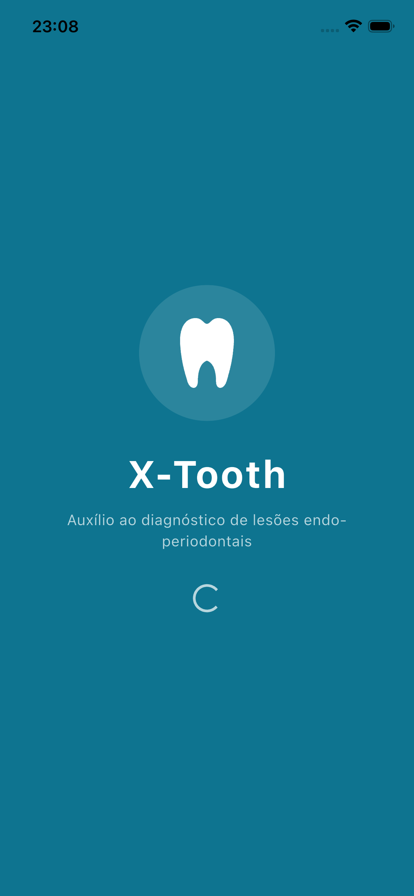
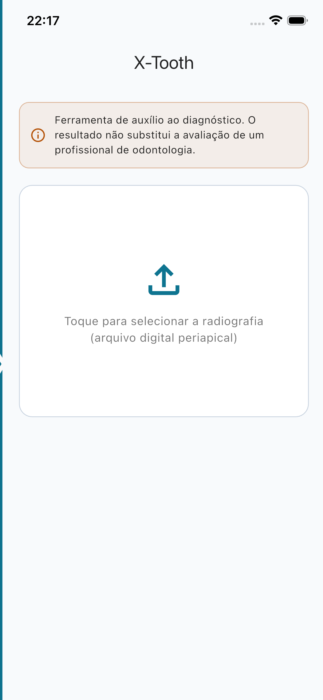
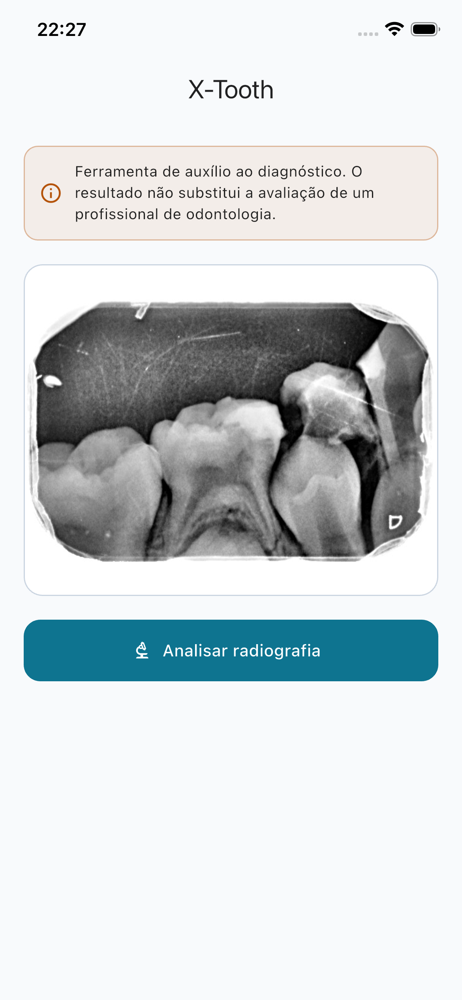
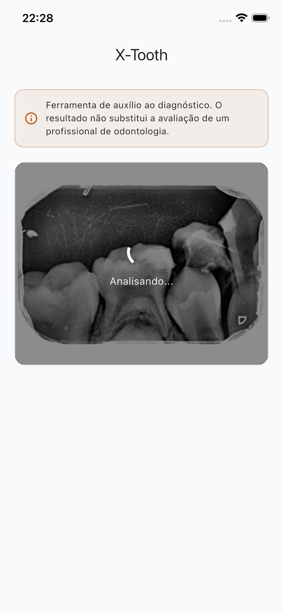
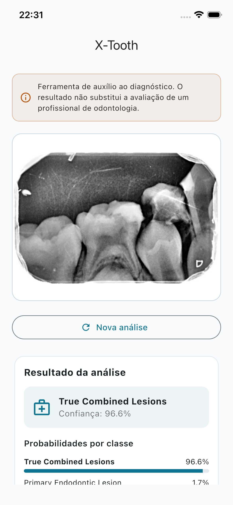
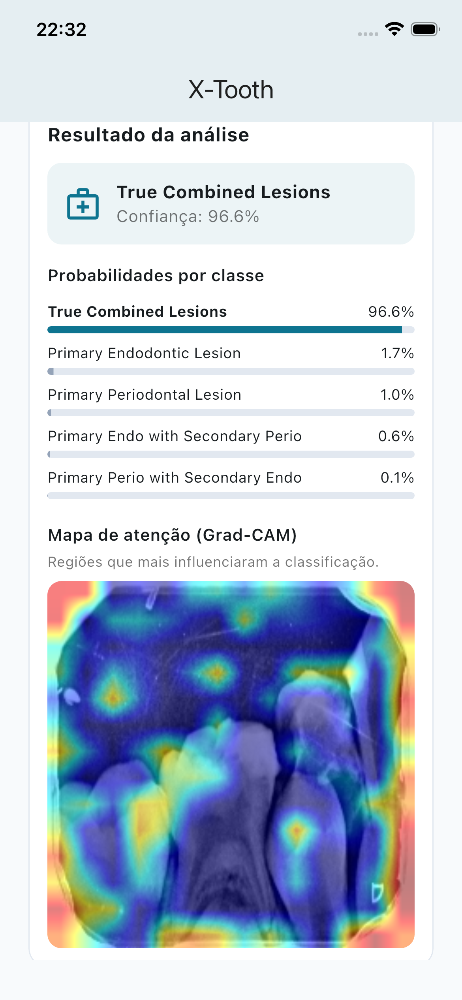
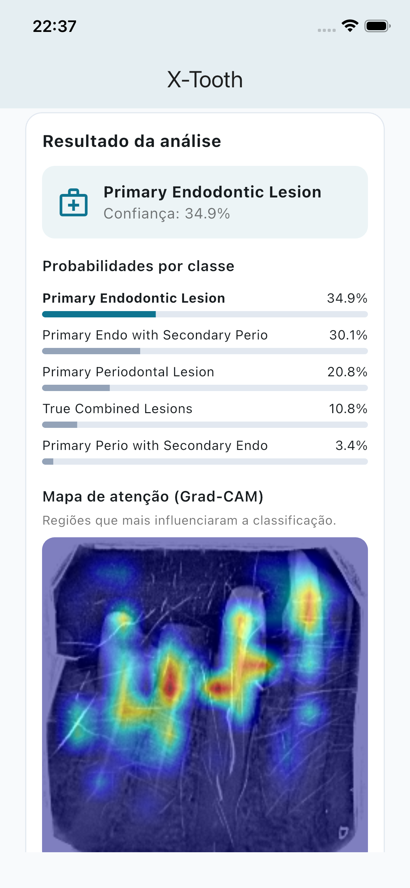
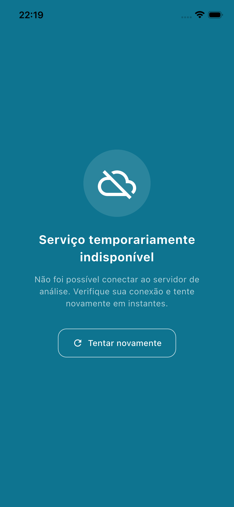

# X-Tooth — Aplicativo

Aplicativo Flutter da ferramenta X-Tooth: o usuário seleciona o arquivo digital de uma radiografia periapical e recebe a classificação da lesão endo-periodontal, a confiança, as probabilidades por classe e o mapa de atenção (Grad-CAM), fornecidos pela [API](../api/) que serve o modelo treinado.

> Ferramenta de auxílio ao diagnóstico — o resultado não substitui a avaliação de um profissional de odontologia.

## Arquitetura

Projeto modular (flutter_modular) com camada de apresentação em MVVM:

```
lib/app/
├── core/                 # compartilhado: tema, constantes, client HTTP (Dio),
│   │                     # erros, splash e componentes de UI
│   └── core_module.dart
└── modules/
    └── diagnosis/        # módulo de domínio
        ├── domain/       # entidade, interface do repositório, estados
        ├── data/         # model (JSON da API) e repositório
        ├── viewmodel/    # ViewModel (ChangeNotifier)
        └── ui/           # páginas e componentes
```

## Como executar

1. Suba a API (ver [`../api/`](../api/)):
   ```bash
   cd ../api && uvicorn main:app --port 8000
   ```
2. Execute o app:
   ```bash
   flutter pub get
   dart run flutter_launcher_icons   # gera os ícones (primeira vez)
   flutter run
   ```

Endereço da API (padrão `http://localhost:8000`, adequado ao simulador iOS) configurável sem alterar código:

```bash
flutter run --dart-define=API_BASE_URL=http://192.168.0.10:8000
```

## Telas

| Splash | Início | Imagem selecionada |
|:---:|:---:|:---:|
|  |  |  |

| Analisando | Resultado | Mapa de atenção (Grad-CAM) |
|:---:|:---:|:---:|
|  |  |  |

| Resultado com confiança baixa | Serviço indisponível |
|:---:|:---:|
|  |  |

O app exibe sempre as probabilidades das cinco classes — não apenas o veredito — para que o profissional pondere os casos em que o modelo apresenta baixa confiança, e verifica a disponibilidade da API na abertura (`GET /health`), com estado dedicado de serviço indisponível.

## Escopo de entrada

A análise aceita somente o **upload do arquivo digital** da radiografia periapical (galeria/arquivos) — o domínio validado pelo protocolo experimental. Captura por câmera não é suportada nesta versão.
